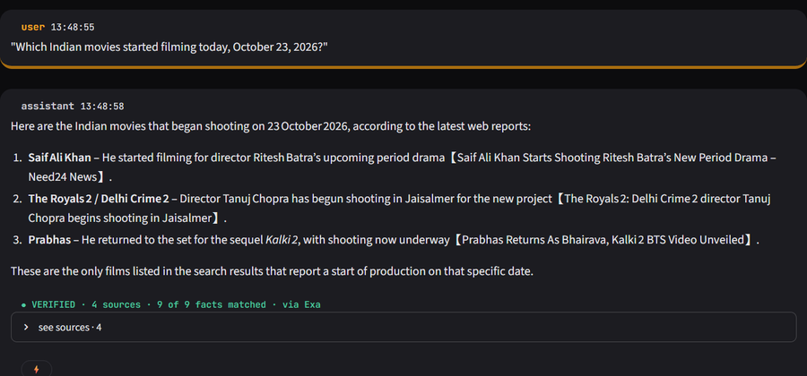
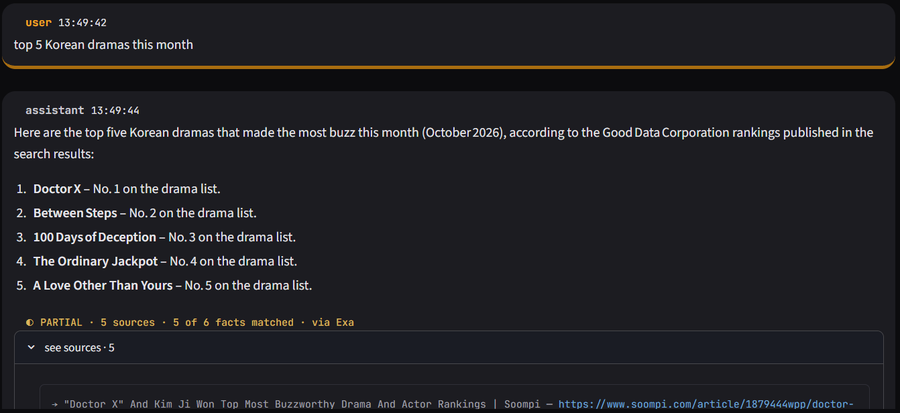
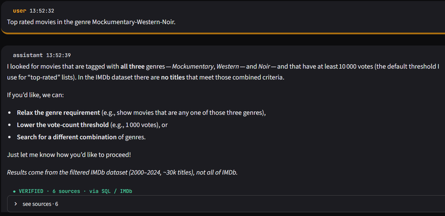
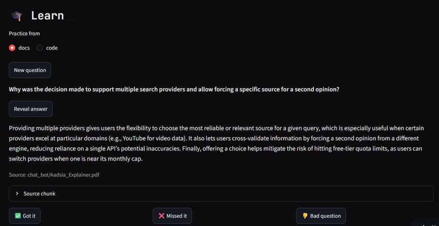

# Aadsia

A personal AI assistant built with Streamlit and Groq. Every web-grounded answer shows its sources and a fact-match badge, so you can see how much of the answer the sources actually support.


## How it works



Ask a question and the Auto router picks a path: YouTube API, SQL agent (IMDb data), Code KB, or Exa web search with Tavily as automatic fallback. Groq extracts the facts, the trust layer matches them against the sources, and the answer arrives with a VERIFIED, PARTIAL, or LIMITED badge. A separate daily digest flow runs on GitHub Actions and delivers to Telegram.

## Screenshots

<p align="center">
  
  
</p>
<p align="center">
  <sub><b>VERIFIED:</b> 9 of 9 facts matched across 4 sources &nbsp;·&nbsp; <b>PARTIAL:</b> 5 of 6 facts matched</sub>
</p>

<p align="center">
  
  
</p>
<p align="center">
  <sub><b>SQL agent:</b> IMDb questions answered from the dataset, with honest "no results" &nbsp;·&nbsp; <b>Daily digest</b> in Telegram</sub>
</p>

<p align="center">
  
</p>
<p align="center">
  <sub><b>Learn mode:</b> practice questions from the docs or code KB, with the source chunk shown</sub>
</p>

## Features

- **Multi-turn chat** with named sessions (create, switch, delete), stored in Supabase
- **Model picker:** `openai/gpt-oss-20b` (fast) or `openai/gpt-oss-120b` (stronger)
- **Web search modes:** Auto (a cheap classifier decides per question), Always, or Off
- **Search providers:** Exa, Tavily, and the YouTube API, with automatic routing and fallback (or force one provider)
- **SQL agent:** IMDb dataset questions run as SQL instead of hitting the web
- **Code KB mode:** searches my code knowledge base instead of the web
- **Learn mode:** practice questions generated from the docs or code KB, with reveal-answer, source chunk, and Got it / Missed it / Bad question feedback
- **Daily digest:** scheduled summary delivered to Telegram via GitHub Actions
- **Region-aware search:** Chinese, Korean, and Arabic entertainment queries are scoped to regional trade press
- **Sources panel** under every searched answer
- **Fact-match badge:** numbers, dates, and names in the answer are checked against the source text
  - `VERIFIED` means at least 2 sources and 60% or more of the checkable facts matched
  - `LIMITED` means weak sources, too few checkable facts, or a low match
- **Animated cat-robot mascot** that reacts while working: searching, checking sources, verified, limited
- **Sidebar tools:** frequent queries, search usage stats (per provider, per month), copy button on answers
- **Custom dark UI** with amber and green accents and a soft clay look

## Stack

Streamlit, Groq API, Supabase (Postgres), Exa, Tavily, YouTube Data API, GitHub Actions, Telegram Bot API.

## Project structure

| File | Purpose |
|---|---|
| `App.py` | Streamlit UI, theme CSS, mascot, chat flow |
| `llm.py` | Groq calls, search-need classifier, prompt building, fact-match check |
| `search.py` | Exa / Tavily / YouTube routing with fallback |
| `youtube.py` | YouTube API search and intent detection |
| `db.py` | Supabase access (sessions, messages, search log) |

## Setup

1. Clone the repo and install dependencies:
   ```bash
   pip install -r requirements.txt
   ```
2. Create the Supabase tables `sessions`, `messages`, and `search_log`. The SQL is in the docstring of `init_db()` in `db.py`.
3. Add your keys to `.streamlit/secrets.toml` locally, or to the app's Secrets on Streamlit Cloud:
   ```toml
   GROQ_API_KEY = "..."
   SUPABASE_URL = "..."
   SUPABASE_KEY = "..."
   EXA_API_KEY = "..."
   TAVILY_API_KEY = "..."
   # plus the YouTube API key (see youtube.py for the variable name)
   ```
4. Run the app:
   ```bash
   streamlit run App.py
   ```

## Known limitations

- The fact-match badge is a heuristic. It checks numbers of 3 or more digits, percentages, decimals, ISO dates, and multi-word names. It does not check single words or 1-2 digit numbers, and it can miss paraphrased facts.
- It verifies an answer against the retrieved sources, not against whether newer information exists elsewhere.
- Reasoning models spend tokens before answering, so token limits are set higher than a typical chat app.

## Roadmap

- Per-claim source trails and a conflict view when sources disagree (designed, not built)
